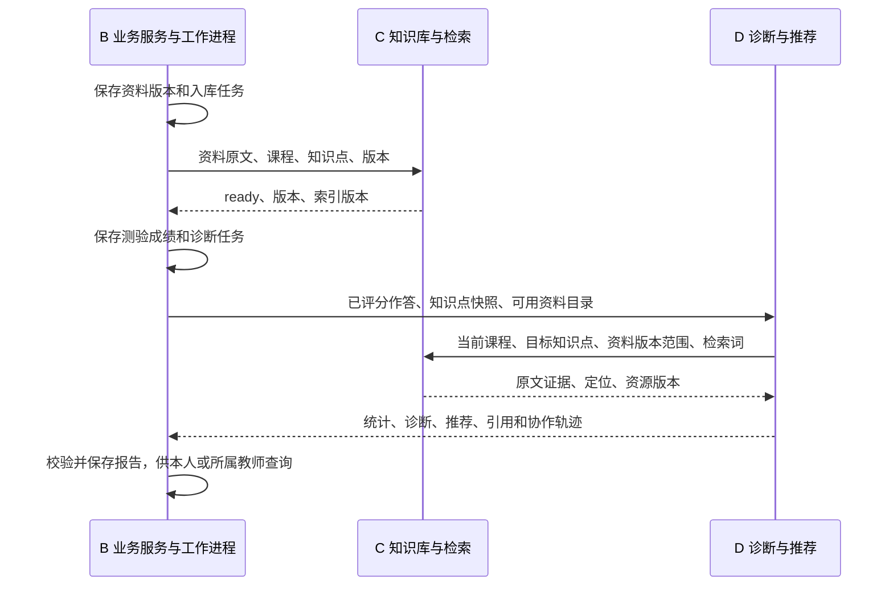

# B、C、D 数据契约 V1（设计稿）

> 当前实施契约以 [内部数据接口与联调说明](内部数据接口与联调说明.md) 和 [诊断任务交付说明](诊断任务交付说明.md) 为准：B 已实现 `/internal` 数据出口、资料索引状态、测验结算同事务通知任务、冻结输入与独立 worker 向 D 交付 ID。本稿以下的 `/internal/v1`、B 主动推送资料、D 同步返回完整报告及报告保存不是当前实现；其不传标准答案等约定也已由完整诊断输入方案调整。本文保留作后续设计参考，不直接用于当前调用。

本稿用于三方确认分工、字段和失败处理，不代表以下 V1 接口已经实现。B 后续已落地资料正文、知识点关联、PDF/DOCX 上传和原件元数据，实际接口见 [资料业务接口说明](资料业务接口说明.md) 与 [资料文件上传说明](资料文件上传说明.md)。本文的文档版本、同步任务、C/D 调用及报告仍属于待接入设计，不能当作当前已实现能力。

建议第一阶段使用“B 持久化任务并异步调用，C/D 同步返回处理结果”的方式。C/D 暂不额外建设一套任务系统；B 在数据库事务提交后，由工作进程调用它们。

## 1. 分工和唯一数据源

| 内容 | 权威维护方 | 其他成员如何使用 |
| --- | --- | --- |
| 用户、角色、课程、章节、知识点 | B | B 校验权限与归属后，把所需上下文放入内部请求 |
| 题库、试卷快照、作答、标准答案、成绩 | B | D 接收已评分结果，不重新判分、不修改成绩 |
| 资料元数据、原文、资料版本、启用/删除状态 | B | B 推送给 C；D 接收 B 冻结的可推荐资料目录 |
| 文档解析、切片、向量/关键词索引、检索证据 | C | 返回可追溯的原文片段和来源定位 |
| 诊断、检索编排、推荐、解释和协作轨迹 | D | 返回结构化报告，由 B 校验并保存 |
| 任务状态、重试、最终报告、学生访问权限 | B | 前端只访问 B，不直接访问 C/D |

三方不直接读写对方的数据库。B 向 C/D 推送经过校验的数据，因此第一阶段不要求 C/D 再调用 B 查询完整课程、学生或题库。



## 2. 公共约定

### 2.1 ID 和类型

| 类型 | 约定 |
| --- | --- |
| B 的业务 ID | 长度 1～64 的非空字符串，原值传递、区分大小写，不通过名称匹配 |
| 用户 ID | 正整数，仅 B 需要处理；本稿的诊断请求不要求传用户名、邮箱或密码 |
| C 的 chunk_id、evidence_id | C 生成的非空字符串，最长 128；B/D 不自行拼造 |
| 时间 | Unix 秒级整数，不使用毫秒或本地时间文本 |
| resource_version | 从 1 开始的正整数，由 B 单调递增 |
| index_version | C 返回的不透明字符串，只记录来源，不解析、不当作数字比较 |
| correct、answered | 严格 JSON 布尔值 true/false |
| accuracy | 0～1 的数字，保留最多六位小数；零样本为 null |
| 数组 | 无数据为 []，不能用 null 或省略代替必填数组 |

新建 B 数据可继续使用 uuid.uuid4().hex。当前的 demo-course-...、demo-q-... 等演示 ID 也合法，无需改为 UUID。示例中的新增资源、文档和诊断 ID 只是说明值，实际联调须使用 B 创建的真实记录。

### 2.2 内部 HTTP

新契约使用 `/internal/v1`，避免向现有严格请求模型直接加入新字段导致 422。

```http
Content-Type: application/json
Authorization: Bearer <内部服务令牌>
X-Service-Name: member-b
X-Request-ID: <链路追踪ID>
Idempotency-Key: <本次业务操作ID>
```

- B 调 C 的入库/删除接口、B 调 D 的诊断接口，需要 Idempotency-Key；同一业务操作重试时保持不变。
- D 调 C 时 X-Service-Name 为 member-d。检索是只读操作，不要求幂等键。
- 内部服务令牌与学生登录 Token 分开；B 才能提交资料、删除资料和发起诊断，D 只能调用检索等所需能力。
- X-Request-ID 随同一次任务在三方传递，用于定位日志；它不代替业务 ID 或幂等键。
- C/D 成功直接返回 JSON，不包 B 对前端使用的 `{code,message,data,request_id}` 外壳。成功响应携带 X-Request-ID 响应头。
- 请求拒绝未知字段，响应读取方允许忽略新增的可选字段。删除字段、改变类型或含义需升级主版本；新增请求字段也应先同步三方模型。

### 2.3 错误格式

```json
{
  "request_id": "trace-demo-001",
  "error": {
    "code": "RESOURCE_VERSION_CONFLICT",
    "message": "相同资源版本对应的内容不一致",
    "retryable": false,
    "details": []
  }
}
```

| HTTP | code 示例 | 含义 |
| --- | --- | --- |
| 401/403 | UNAUTHORIZED / FORBIDDEN | 内部身份无效或调用方无权限 |
| 404 | RESOURCE_NOT_FOUND | 当前课程下不存在可见资源 |
| 409 | RESOURCE_VERSION_CONFLICT / STALE_RESOURCE_VERSION | 版本或内容冲突，不原样盲目重试 |
| 409 | IDEMPOTENCY_CONFLICT | 同一幂等键被用于不同请求体 |
| 409 | OPERATION_IN_PROGRESS | 相同操作正在处理；retryable=true，带 Retry-After |
| 422 | INVALID_REQUEST / UNSUPPORTED_POLICY | 字段、关联或统计策略不符合约定 |
| 429 | RATE_LIMITED | 按 Retry-After 重试 |
| 503 | SERVICE_UNAVAILABLE | 服务暂不可用，可重试 |

错误不得包含服务口令、数据库连接串、学生密码或完整内部堆栈。C/D 在内部日志记录原始异常及 request_id。

## 3. Resource：B 管理的资料对象

建议 B 持久化以下信息；这里是逻辑对象，不限定必须如何拆表：

| 字段 | 类型 | 说明 |
| --- | --- | --- |
| resource_id | string | 一份逻辑资料的固定 ID |
| course_id | string | 所属课程，创建后不通过更新变更归属 |
| title | string | 标题，1～200 字符 |
| knowledge_point_ids | string[] | 本课程知识点，去重，至少一个 |
| source | string | 来源说明，1～1000 字符 |
| resource_version | integer | 原文、标题、知识点标签或删除状态改变时递增 |
| document_id | string | 此版本的文档 ID；每个资料版本新建，旧版本不复用 |
| text | string | 本阶段直接提交纯文本，1～200000 字符 |
| content_sha256 | string | 实际传输 text 的 UTF-8 字节 SHA-256，64 位小写十六进制 |
| status | string | B 的业务状态：active / deleted |
| index_status | string | B 的处理状态：pending / processing / ready / failed；删除完成为 deleted |
| created_at、updated_at | integer | B 的创建和更新时间 |

resource_id、document_id 均由 B 生成；C 生成 chunk_id、evidence_id。resource_version 区分资料版本，index_version 记录检索服务的索引状态，两者不能混用。

第一阶段 B 向 C 传 text，不传本机绝对路径，也不要求 C 下载浏览器临时地址。B 已能提取 PDF/DOCX 正文，但尚未实际向 C 同步；以后若让 C 直接解析原件，仍需另行约定文件访问、原件版本和位置映射。

B 的义务：校验教师所有权和知识点所属课程；在同一数据库事务中保存版本与待处理任务；事务提交后再调用 C。处理回执只有在版本仍等于 B 当前版本且资料未删除时，才能将当前资料标记 ready。

## 4. B → C：资料入库

```http
POST /internal/v1/ingest
Idempotency-Key: ingest-resource-stack-guide-v1
```

请求：

```json
{
  "resource_id": "resource-stack-guide",
  "resource_version": 1,
  "document_id": "document-stack-guide-v1",
  "course_id": "demo-course-ds-teacher-2",
  "title": "栈的基本概念与操作",
  "knowledge_point_ids": ["demo-kp-stack-concept", "demo-kp-stack-operations"],
  "source": "课程教师自编材料",
  "text": "栈遵循后进先出原则。入栈、出栈和读取栈顶都围绕栈顶进行。",
  "content_sha256": "fb450077d9efa90648c5a153b4eed4ebbb6bac9344ebe734c0d66e9bcc4af96b"
}
```

成功 HTTP 200：

```json
{
  "resource_id": "resource-stack-guide",
  "resource_version": 1,
  "document_id": "document-stack-guide-v1",
  "course_id": "demo-course-ds-teacher-2",
  "state": "ready",
  "chunks": 1,
  "index_version": "index-ds-0001",
  "processed_at": 1794659000
}
```

C 的义务：

1. 验证摘要和字段，不对收到的 text 再做影响摘要的隐式改写。B 若要规范换行，应在计算摘要、发送前完成。
2. 完成解析、切片、索引后才返回 ready。失败时保留之前可用版本，不能让半份新文档对检索可见。
3. 新版本切换为可检索版本时，旧版本不再默认可检索。并发写入同一资源要按版本协调。
4. 当前版本下，相同 resource_id、resource_version、document_id 和完整请求内容重复提交时返回原处理结果，不重复切片。
5. 相同资源版本对应不同内容/元数据返回 409；低于已接受的最高版本返回 STALE_RESOURCE_VERSION。
6. content_sha256 只校验正文；检测“同版本不同请求”时须同时比较标题、课程、文档 ID、标签和来源，不能只比较正文摘要。

最高版本和删除标记的检查优先于旧的成功回执；过期版本即使曾入库成功，也返回 STALE_RESOURCE_VERSION，不重建索引。用于比较请求的 input_hash 按规范化 JSON 计算：对象键排序、保留数组顺序、UTF-8 编码；收到的资料正文不额外改变。

若 B 调用超时，不能断定 C 没有入库。B 可查询状态，或使用原请求与原幂等键重试。

## 5. B → C：删除与状态核对

### 5.1 删除

```http
POST /internal/v1/resources/resource-stack-guide/delete
Idempotency-Key: delete-resource-stack-guide-v2
```

```json
{
  "course_id": "demo-course-ds-teacher-2",
  "resource_version": 2
}
```

成功 HTTP 200：

```json
{
  "resource_id": "resource-stack-guide",
  "resource_version": 2,
  "document_id": null,
  "course_id": "demo-course-ds-teacher-2",
  "state": "deleted",
  "chunks": 0,
  "index_version": "index-ds-0002",
  "processed_at": 1794659100
}
```

B 先在业务库逻辑删除、增加版本并排入同步任务；学生立刻不能从 B 获取该资料。C 删除活动索引并保留最高版本的删除标记。即使 C 尚未见过此资源，也记录该删除版本。

例如 v2 删除完成后，迟到的 v1 入库不能让资料复活，必须返回 STALE_RESOURCE_VERSION。重复同一 v2 删除是幂等的。第一阶段不支持恢复已删除资料；重新上传使用新的 resource_id。

### 5.2 状态

```http
GET /internal/v1/resources/resource-stack-guide?course_id=demo-course-ds-teacher-2
```

返回 C 当前已接受版本的状态，字段同入库/删除回执。C 未见过该资源返回 404；已删除返回 200 和 state=deleted。同步处理尚未完成时，调用方依靠幂等重试获得结果，不要求此接口暴露一套 C 的异步任务状态。

## 6. B → D：发起诊断

```http
POST /internal/v1/diagnoses
Idempotency-Key: diagnosis-demo-001
```

B 只提交 submitted 或 expired 的最终作答。该接口由 B 的工作进程调用，前端提交成绩不等待它完成。

下面是一份独立三题作答的格式示例。实际提交必须包含试卷全部题目的最终评分，不得只提交错题，也不得截取现有十题测验的三题冒充完整作答。

```json
{
  "diagnosis_id": "diagnosis-demo-001",
  "attempt_id": "attempt-demo-001",
  "course_id": "demo-course-ds-teacher-2",
  "attempt_status": "submitted",
  "submitted_at": 1794659200,
  "assessment_policy": "kp-accuracy-v1",
  "graded_answers": [
    {"question_id": "demo-q-ds-01", "knowledge_point_ids": ["demo-kp-stack-concept"], "answered": true, "correct": false},
    {"question_id": "demo-q-ds-02", "knowledge_point_ids": ["demo-kp-stack-concept"], "answered": true, "correct": false},
    {"question_id": "demo-q-ds-03", "knowledge_point_ids": ["demo-kp-stack-concept"], "answered": true, "correct": false}
  ],
  "knowledge_points": [
    {"id": "demo-kp-stack-concept", "name": "栈的基本概念"}
  ],
  "resource_catalog": [
    {
      "resource_id": "resource-stack-guide",
      "resource_version": 1,
      "document_id": "document-stack-guide-v1",
      "title": "栈的基本概念与操作",
      "knowledge_point_ids": ["demo-kp-stack-concept"]
    }
  ],
  "baseline": null
}
```

| 字段 | 规则 |
| --- | --- |
| diagnosis_id | B 为这次诊断任务生成；与幂等键一致 |
| attempt_id、course_id | 真实作答和课程 ID，B 验证所属关系 |
| attempt_status | submitted / expired；进行中不能生成正式报告 |
| assessment_policy | 本版固定 kp-accuracy-v1，未知策略返回 422 |
| graded_answers | 1～100 条；question_id 唯一；包含未答题；第一阶段每题一个主知识点 |
| answered | 从最终 selected_option_ids 是否为空得出；false 时 correct 必须为 false |
| correct | B 的判分结果，D 不重新判分 |
| knowledge_points | 使用此作答保存的知识点目录快照，ID 唯一，包含试卷未覆盖的目录项 |
| resource_catalog | B 当前 active 且当前版本已 ready 的同课程资料；允许为空 |
| baseline | 初测为 null；复测为本人同课程另一份已完成作答的统计快照 |

resource_catalog 中的标签是原资料标签与此次 knowledge_points 的交集；没有交集的资料不进入目录。这样资料后来关联了新知识点，也不会把新 ID 强塞进旧试卷的诊断上下文。

D 校验作答知识点全部存在于 knowledge_points，资源 ID 不重复，资源标签属于此次上下文。B 在任务创建时冻结完整输入；重试不得临时换入新的资料版本或新的统计。

本阶段不传标准答案、密码、邮箱或完整用户对象。只有正确/错误证据时，D 可以分析知识点表现，不能声称已经识别到学生的具体思维误区。以后要加入题干、所选选项文本等，应另行明确扩展字段及使用范围。

### 6.1 复测 baseline

有基准时，baseline 替换为：

```json
{
  "attempt_id": "attempt-baseline-001",
  "assessment_policy": "kp-accuracy-v1",
  "knowledge_points": [
    {
      "knowledge_point_id": "demo-kp-stack-concept",
      "name": "栈的基本概念",
      "correct_count": 1,
      "sample_count": 3,
      "accuracy": 0.333333,
      "status": "weak"
    }
  ]
}
```

基准与当前策略必须相同。correct_count 不能超过 sample_count，accuracy 和 status 必须与计数匹配。双方对同一知识点均至少三题时才比较；不同试卷的正确率差不解释为推荐导致的因果提升。

## 7. D → C：检索证据

```http
POST /internal/v1/retrieve
```

```json
{
  "course_id": "demo-course-ds-teacher-2",
  "query": "栈的后进先出原则和入栈出栈操作",
  "knowledge_point_ids": ["demo-kp-stack-concept"],
  "resource_scope": [
    {
      "resource_id": "resource-stack-guide",
      "resource_version": 1,
      "document_id": "document-stack-guide-v1"
    }
  ],
  "top_k": 5
}
```

| 字段 | 规则 |
| --- | --- |
| course_id | 必填，禁止默认退回静态 course-ds |
| query | 1～1000 字符 |
| knowledge_point_ids | 去重，单次最多 50 个；D 超过时分批检索 |
| resource_scope | 必填，取自 B 提供的目录；空数组代表没有允许检索的资源，不能解释为全库 |
| top_k | 1～10，默认 5 |

课程、允许的资源版本、知识点过滤是同时生效的限制。多知识点采用“任一目标标签命中”，不是要求一条资料包含所有标签；空知识点数组表示不额外按标签过滤，但仍限制课程和资源范围。

成功 HTTP 200：

```json
{
  "course_id": "demo-course-ds-teacher-2",
  "mode": "keyword_demo",
  "index_version": "index-ds-0001",
  "evidence": [
    {
      "evidence_id": "evidence-stack-guide-v1-001",
      "document_id": "document-stack-guide-v1",
      "resource_id": "resource-stack-guide",
      "resource_version": 1,
      "course_id": "demo-course-ds-teacher-2",
      "chunk_id": "chunk-stack-guide-v1-001",
      "knowledge_point_ids": ["demo-kp-stack-concept", "demo-kp-stack-operations"],
      "title": "栈的基本概念与操作",
      "text": "栈遵循后进先出原则。入栈、出栈和读取栈顶都围绕栈顶进行。",
      "score": 1.0,
      "location": {"kind": "text", "start": 0, "end": 28},
      "source": "课程教师自编材料"
    }
  ],
  "unavailable_resources": []
}
```

约束：

- evidence 必须来自指定课程和 resource_scope 中完全匹配的资源、版本、文档。
- text 是原文片段，不能把模型生成的解释当作检索原文。纯文本 start/end 为收到的 text 的 Unicode 字符位置，0 起始、左闭右开。
- score 为有限数字、越高越相关；是当前检索算法的排序信号，不是可信概率，不要求落在 0～1，也不跨算法直接比较。
- mode 如实使用 keyword_demo / vector_rag / hybrid_rag；当前 C 的关键词实现不能标为向量 RAG。
- 同一 evidence_id 在一次响应中唯一。D 保留 C 返回的来源，不重新编造 chunk_id 或定位。
- C 不能检索到请求版本时，跳过该资源，放入 unavailable_resources，原因取 not_available / version_changed。不能自动换成最新版本，也不能越过 resource_scope 找其他资源。
- 无命中仍返回 200、evidence=[]。网络或索引故障返回 503，与“成功检索但没命中”区分。

unavailable_resources 每项为 `{resource_id, resource_version, document_id, reason}`。本版不要求 C 永久保留旧索引用于重新检索；B 保存报告使用的证据文本和版本以供历史查阅。index_version 只记录本次检索来源，不保证可据其重放历史检索。

## 8. D → B：诊断报告

诊断请求在 D 内完成后返回 HTTP 200；下例与前述三题请求对应：

```json
{
  "diagnosis_id": "diagnosis-demo-001",
  "attempt_id": "attempt-demo-001",
  "course_id": "demo-course-ds-teacher-2",
  "status": "completed",
  "mode": "rule_template_demo",
  "engine_version": "diagnosis-rule-v1",
  "models": [],
  "assessment_policy": "kp-accuracy-v1",
  "created_at": 1794659250,
  "knowledge_points": [
    {
      "knowledge_point_id": "demo-kp-stack-concept",
      "name": "栈的基本概念",
      "sample_count": 3,
      "correct_count": 0,
      "unanswered_count": 0,
      "accuracy": 0,
      "status": "weak",
      "evidence_question_ids": ["demo-q-ds-01", "demo-q-ds-02", "demo-q-ds-03"]
    }
  ],
  "evidence": [
    {
      "evidence_id": "evidence-stack-guide-v1-001",
      "document_id": "document-stack-guide-v1",
      "resource_id": "resource-stack-guide",
      "resource_version": 1,
      "course_id": "demo-course-ds-teacher-2",
      "chunk_id": "chunk-stack-guide-v1-001",
      "knowledge_point_ids": ["demo-kp-stack-concept"],
      "title": "栈的基本概念与操作",
      "text": "栈遵循后进先出原则。入栈、出栈和读取栈顶都围绕栈顶进行。",
      "score": 1.0,
      "location": {"kind": "text", "start": 0, "end": 28},
      "source": "课程教师自编材料"
    }
  ],
  "recommendations": [
    {
      "knowledge_point_id": "demo-kp-stack-concept",
      "resource_id": "resource-stack-guide",
      "resource_version": 1,
      "document_id": "document-stack-guide-v1",
      "title": "栈的基本概念与操作",
      "reason": "该知识点三题均未答对，建议结合原文复习后进先出原则并完成对应练习。",
      "basis": "retrieval",
      "evidence_ids": ["evidence-stack-guide-v1-001"]
    }
  ],
  "explanation": "本次测验在栈的基本概念上表现偏弱，建议复习并通过新的测验进一步观察。此结果来自规则统计与检索资料。",
  "comparison": [],
  "trace": [
    {"agent": "diagnosis", "status": "completed"},
    {"agent": "retrieval", "status": "completed"},
    {"agent": "recommendation", "status": "completed"}
  ],
  "warnings": []
}
```

### 8.1 评分与统计策略

kp-accuracy-v1 与 B 现有基础规则保持一致：

| 条件 | status |
| --- | --- |
| sample_count < 3 | insufficient_evidence |
| sample_count ≥3，accuracy <0.6 | weak |
| sample_count ≥3，0.6≤accuracy<0.8 | needs_practice |
| sample_count ≥3，accuracy≥0.8 | mastered |

sample_count 是该知识点关联的不同题数，未答计入样本且为错；正确率不按分值加权。未覆盖知识点 sample_count=0、correct_count=0、unanswered_count=0、accuracy=null。unanswered_count 由 answered=false 统计；D 必须在解释中区分未答与答错，不能从空答案推断具体认知错误。标签描述的是本次测验表现，不是经过校准的能力估计。

D 可按同一策略重算统计用于校验，但不得修改 B 的分数。B 保存报告前检查计数、正确率和题目引用与提交输入一致；不一致的报告不能标记为成功。

### 8.2 引用和推荐约束

- 报告三个身份字段必须与 B 请求一致，所有题目引用来自此次 graded_answers。
- 推荐资源、版本和文档必须来自 B 的 resource_catalog，推荐知识点必须属于此次 knowledge_points 和该资料的上下文标签。
- D 输出 evidence 时可把知识点标签收窄为当前上下文的交集；不得更改原文、课程、文档/资源版本、定位或编造证据。
- basis=retrieval 时 evidence_ids 至少一项，均指向报告 evidence；这些证据必须属于推荐的资源版本并覆盖推荐知识点。
- 没有证据时，允许 basis=catalog_only 的目录建议，evidence_ids=[]，reason 必须说明“仅依据测验表现与目录，尚无检索证据”。不得把它描述为 RAG 证实的结论。
- 样本不足的知识点不生成针对薄弱程度的推荐和提升判断，可提示补充测验。
- 资料后来更新/删除时，历史报告保留原引用；前端访问资料仍由 B 按当前状态和权限处理，不直接信任报告中的外部下载地址。

### 8.3 完成、降级与失败

| 情况 | HTTP / 报告状态 | 约定 |
| --- | --- | --- |
| 规则、检索和推荐按需完成 | 200 / completed | 返回完整报告 |
| 没有满足题量的薄弱/待巩固知识点 | 200 / completed | 跳过检索，推荐可为空，轨迹标记 skipped |
| 有诊断目标但无可用资料或检索未命中 | 200 / partial | 保留基础统计，明确缺少资料/证据 |
| C 超时或不可用，但基础报告可生成 | 200 / partial | evidence=[]，允许明确标注的目录建议，warnings 标明 RAG_TIMEOUT / RAG_UNAVAILABLE |
| D 无法产出符合契约的基础报告 | 503 | B 的诊断任务失败，已保存成绩不受影响 |

warnings 每项为 `{code,message}`，可用 NO_ELIGIBLE_RESOURCES、NO_EVIDENCE、RESOURCE_VERSION_UNAVAILABLE、RAG_TIMEOUT、RAG_UNAVAILABLE。trace.status 使用 completed / skipped / degraded / failed，并与实际执行一致。

mode=rule_template_demo 表示规则模板；真正接入模型和多智能体执行后才使用 multi_agent_llm。engine_version 为 D 的实现版本标识；models 为实际调用的模型记录数组，每项 `{agent,provider,name,prompt_version}`，均为非空字符串，不含密钥；纯规则流程为空数组。联调走真实 C 时不能在失败后悄悄切回 mock 并宣称成功；开发 mock 必须单独标识，不能混入真实报告。

comparison 每项为 `{knowledge_point_id,before_accuracy,after_accuracy,delta}`；只比较双方均达到三题的共同知识点。无基准或样本不足返回 []。

## 9. B 的任务状态、幂等与并发

B 统一保存任务：`task_id, task_type, business_id, input_snapshot, input_hash, status, attempt_count, next_retry_at, last_error, created_at, updated_at`。task_type 初版为 resource_ingest、resource_delete、diagnosis。

任务状态采用 pending → running → succeeded / failed。D 返回 partial 报告时，任务仍为 succeeded，报告质量状态单独保存为 partial，避免把“任务执行失败”和“证据不足的有效报告”混在一起。

| 场景 | 必须做到 |
| --- | --- |
| 业务保存成功但工作进程尚未调用 | 任务与业务在同一事务提交，重启后仍能继续领取 |
| 领取任务后进程退出 | 设置租约/超时回收，不能永久停在 running |
| 请求超时但对方可能已经完成 | 使用原幂等键及完全相同输入重试，禁止直接新建重复任务 |
| 同一幂等键和不同输入 | 409 IDEMPOTENCY_CONFLICT |
| 已完成的同一诊断重复调用 | 返回第一次持久化保存的结果，不重复调用模型 |
| 临时失败后重试 | 最多三次总尝试，指数退避；429/OPERATION_IN_PROGRESS 尊重 Retry-After |
| 400/401/403/404/422 或版本冲突 | 不原样盲目重试，记录失败并修正输入/权限/版本 |
| 显式重新生成诊断 | B 创建新的 diagnosis_id 和新的冻结输入；旧报告保留，不覆盖历史 |
| 成绩事务与诊断 | 成绩先提交；诊断失败不回滚、不重新评分 |

B 持久化任务表可承担初期任务队列，不强制引入消息中间件。HTTP 超时参数由部署配置，诊断应使用独立于普通短请求的超时。失败的暂存处理不能永久占用幂等键阻止恢复重试。

C/D 的成功幂等回执和输入摘要需要持久化，不能只依赖进程内缓存；D 在返回成功前保存完整结果。B 对 diagnosis_id 做唯一约束，保证一次任务只有一份可见结果。进程在模型调用后、保存前退出时，恢复可能重做计算，不能据此宣称外部模型调用具有严格的“恰好一次”执行保证。

B 保存/展示新报告时再次确认资源仍有权使用；若资料已删除或版本变化，不生成新的有效资料访问入口，并向前端标记引用已失效。后续重新生成报告使用当前可用目录。

## 10. 与当前代码的对应关系

| 当前真实接口/数据 | 可以复用 | V1 需要增加或调整 |
| --- | --- | --- |
| B：GET /teacher/attempts/{id}/diagnosis-input | attempt_id、course_id、graded_answers、knowledge_points、baseline | 包装诊断任务、answered、策略标识、真实资料目录和版本；不能直接把 B 的外层包装传 D |
| C：POST /internal/ingest | resource_id、document_id、course_id、title、text、knowledge_point_ids、source | 版本、摘要、幂等、原子切换、删除版本保护 |
| C：POST /internal/retrieve | course_id、query、knowledge_point_ids、top_k | 明确资料版本范围、版本不可用列表、结构化定位和版本来源 |
| C：GET /internal/resources、DELETE /internal/resources/{id} | 资源查询和删除的基础逻辑 | 删除标记、版本检查、状态核对 |
| D：POST /internal/diagnose-and-recommend | 已评分输入、基础统计、推荐、证据、comparison、trace | 诊断幂等、answered、资料版本、证据引用、partial/warnings 和策略版本 |

当前 C 是 keyword_demo，D 是 rule_template_demo；D 的 RAG_MODE=http 才实际调用 C。当前 B 已有纯文本资料管理，但未同步或实际调用 C/D，resource_catalog 仍为空。现有模型配置 extra=forbid，不能把本文新增字段直接塞入旧接口。

落地时建议新增本稿的 /internal/v1 路由和对应模型，旧接口保留作开发兼容；B 的新客户端只调用 V1。前端继续调用 B 的现有 /user、/teacher、/courses、/attempts 路径，不增加 /api/v1 前缀。

## 11. 三方交付与联调验收

| 成员 | 首批交付 |
| --- | --- |
| B | 资料版本和任务持久化、资料 CRUD、可靠调用 C/D、报告保存与权限查询 |
| C | V1 入库、删除和状态核对、限定课程/版本范围的检索、可定位证据 |
| D | V1 已评分输入校验、统一统计策略、检索与推荐编排、可引用报告、幂等处理 |

先冻结本稿字段和一组共享样例，再并行实现。建议按以下场景验收：

1. 资料入库成功后，B 标记正确版本 ready，C 的片段可定位到原文。
2. 相同入库重复提交不增加片段；相同版本不同内容返回 409。
3. 资料更新后旧版本不被自动替换成新版本返回；旧范围请求明确报告不可用。
4. v2 删除后迟到的 v1 入库不能复活资料。
5. 两门课程存在同名知识点时，检索和推荐仍不能跨课程。
6. 真实完成测验后报告统计与 B 一致；零覆盖项为 accuracy=null，未答可区分。
7. C 停止运行时成绩仍保存，报告明确 partial 或任务 failed，不出现伪造检索证据。
8. 所有推荐 ID 来自输入目录，retrieval 类型建议都能追溯到报告 evidence。
9. 同一诊断幂等重试只产生一次报告；显式重新生成产生新的 diagnosis_id。
10. 本人、所属教师能经 B 查看报告；其他学生或教师不能读取。
