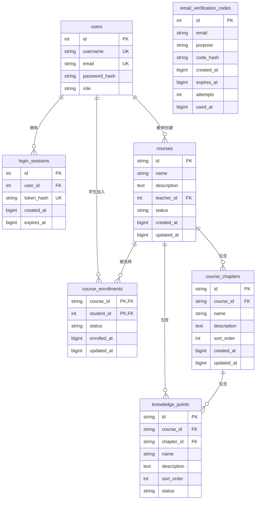

# 数据模型详细说明

本文依据当前 `app/models.py`、`app/database.py`、注册服务及认证代码编写，描述代码声明及其使用方式，不代表已连接某个 MySQL 实例核验其表结构。接口请求模型另见 [接口详细说明](接口详细说明.md)。

## 1. 模型总览

当前使用 SQLAlchemy 2 风格的 `Mapped`、`mapped_column` 声明模型，统一继承 `app.database.Base`，数据库为 MySQL。

| Python 模型 | 数据库表 | 用途 | 主要读写入口 |
| --- | --- | --- | --- |
| `User` | `users` | 用户账号、密码哈希和角色 | 注册、登录、鉴权、信息查询、重置密码 |
| `LoginSession` | `login_sessions` | 可撤销的登录会话 | 登录、鉴权、退出、重置密码撤销全部会话 |
| `EmailVerificationCode` | `email_verification_codes` | 邮箱注册及重置密码验证码摘要和状态 | 发送验证码、注册、重置密码 |
| `Course` | `courses` | 教师课程、介绍和发布状态 | 教师创建、列表、详情及修改，学生课程查询 |
| `CourseChapter` | `course_chapters` | 课程章节、说明和展示顺序 | 教师添加章节，课程详情内容树 |
| `KnowledgePoint` | `knowledge_points` | 课程知识点、章节归属和启用状态 | 教师添加知识点，课程发布校验和内容树 |
| `CourseEnrollment` | `course_enrollments` | 学生选课、退课和重新加入的当前状态 | 学生选退课、已选列表、课程可见性及人数统计 |
| `Question` | `questions` | 同课程客观题库 | 教师维护、组卷、发布 |
| `QuestionOption` | `question_options` | 当前题目选项及答案标记 | 教师题目维护 |
| `QuestionKnowledgePoint` | `question_knowledge_points` | 同课程题目知识点关联 | 教师维护及发布校验 |
| `Exam` | `exams` | 试卷、时长、发布状态及知识点目录快照 | 教师组卷、发布和学生开始 |
| `ExamQuestion` | `exam_questions` | 试卷题目、分值、发布快照 | 发布冻结、取题、评分 |
| `ExamAttempt` | `exam_attempts` | 学生限时作答、成绩和统计 | 开始、提交、超时、历史与复测 |
| `ExamAnswer` | `exam_answers` | 保存答案、版本及逐题成绩 | 答案保存与评分 |
| `CourseResource` | `course_resources` | 纯文本资料、来源、版本和删除状态 | 教师管理及有效选课学生阅读 |
| `ResourceKnowledgePoint` | `resource_knowledge_points` | 同课程资料与知识点关联 | 教师创建、修改及知识点过滤 |
| `ResourceFile` | `resource_files` | 上传原件元数据、提取信息和私有存储键 | PDF/DOCX 上传、鉴权下载 |
| `ResourceIndexState` | `resource_index_states` | 当前目标版本、C 索引结果和脱敏错误 | 资料写入事务、C 内部回报、D 可用资料目录 |
| `DiagnosisTask` | `diagnosis_tasks` | 唯一测验通知、冻结输入、租约、D 接收回执和重试 | 评分同事务入队、独立投递 worker、学生/教师任务查询 |

当前启用十九个 ORM 模型。题库及测验七个模型见 [测验数据模型说明](测验数据模型说明.md)，资料正文与关联两个模型见 [资料业务接口说明](资料业务接口说明.md)，原件元数据模型见 [资料文件上传说明](资料文件上传说明.md)，索引状态表见 [内部数据接口与联调说明](内部数据接口与联调说明.md)，诊断通知表的十四个字段、唯一约束、租约及迁移见 [诊断任务交付说明](诊断任务交付说明.md)。下方关系图展示课程与账号关系，其他模块关系图见对应文档。`fixtures.py` 中的数据不会自动导入数据库；课程演示初始化可使用 [SQL 文件说明](../sql/README.md)。请求校验模型不会创建数据库表。

### 1.1 关系



`email_verification_codes` 不与 `users` 建立外键关系：注册验证码产生时用户尚未注册，重置验证码则只向已注册邮箱发送。服务通过规范化后的邮箱和用途查找对应记录，`email + purpose` 共同唯一。删除用户不会自动删除邮箱验证码记录。当前没有图片验证码模型。

### 1.2 时间和默认值约定

- 所有时间字段均为 Unix 时间戳，单位为秒，使用 `BIGINT` 存储；字段本身不携带时区。
- `expires_at <= 当前时间` 即失效，达到到期时刻也视为过期。
- 下文“ORM 默认值”由 SQLAlchemy 插入时应用，不等于 MySQL 列的 `DEFAULT`。
- `role` 同时声明 ORM 默认值及数据库默认值；其他时间、次数字段的默认行为按各表说明执行。
- 逻辑失效不会自动删除数据；只有代码中明确执行的清理操作才删除记录。

## 2. User：用户模型

定义：`app/models.py` 中的 `User`，表名 `users`。

### 2.1 字段

| 字段 | Python 类型 | MySQL 类型 | 可空 | 默认值 | 含义 |
| --- | --- | --- | --- | --- | --- |
| `id` | `int` | `INTEGER` | 否 | 自增 | 主键，供会话关联和接口返回 |
| `username` | `str` | `VARCHAR(64)` | 否 | 无 | 唯一用户名，登录标识 |
| `password_hash` | `str` | `VARCHAR(256)` | 否 | 无 | 密码的加盐哈希结果 |
| `email` | `str` | `VARCHAR(255)` | 否 | 无 | 唯一邮箱，注册验证目标 |
| `role` | `str` | `VARCHAR(20)` | 否 | ORM 和数据库均为 `student` | 角色，允许 `student`、`teacher` |

当前没有 `age`、`created_at`、`updated_at`、账号禁用或软删除字段。用户名、邮箱的大小写等价及唯一性细节受实际 MySQL 列排序规则影响，模型没有指定排序规则。

### 2.2 约束

| 声明 | 作用 |
| --- | --- |
| `PRIMARY KEY (id)` | 用户主键唯一 |
| `UNIQUE (username)` | 用户名不可重复 |
| `UNIQUE (email)` | 邮箱不可重复 |
| `ck_users_username_length` | `CHAR_LENGTH(username) BETWEEN 3 AND 64` |
| `ck_users_role` | `role IN ('student', 'teacher')` |

用户名、邮箱唯一声明会建立相应唯一索引；没有额外重复声明普通索引。ORM 声明不保证已有表已经迁移到同样的约束，实际情况需通过 `SHOW CREATE TABLE users` 核对。

### 2.3 数据库约束与接口校验的区别

数据库只约束用户名长度、角色范围、唯一性及非空，不负责邮箱格式、密码强度、两次密码一致性和验证码正确性。

注册及登录入口会对用户名去除首尾空白，限制长度 3～64，并按 `^[\w-]+$` 校验字符；邮箱去除首尾空白并整体转为小写。注册请求可传入 `role`，仅允许 `student`、`teacher`，不传默认 `student`；通过校验后按所选角色写入 `users.role`。登录只验证密码长度及其与哈希是否匹配，不要求验证码。

角色选择复用现有 `role` 列及 `ck_users_role` 约束，无需迁移表结构。新增选择不会修改已有账号角色；注册成功响应、登录响应和当前用户信息接口均使用实际存储的角色。

### 2.4 密码存储

当前实现位于 `app/security.py`：

1. `secrets.token_hex(16)` 生成 16 字节随机数对应的 32 字符十六进制盐。
2. 使用 `hashlib.pbkdf2_hmac('sha256', password.encode(), salt.encode(), 180000)` 派生摘要。
3. 将盐文本和摘要十六进制文本拼接为 `salt$digest`。
4. 仅将上述结果写入 `password_hash`；确认密码和原始密码不入库。

现有格式的盐部分为 32 字符，摘要部分为 64 字符，加分隔符总长 97 字符。盐传入 PBKDF2 的是十六进制文本编码，而不是将其还原后的字节。验证时复用存储的盐，并用 `hmac.compare_digest` 比较结果。

同一密码分别注册会产生不同盐和哈希。不要自行向该列写入明文或其他不兼容格式；当前格式没有单独记录算法版本或迭代次数。

密码重置复用相同哈希实现，生成新盐并覆盖 `password_hash`，不增加用户行，不保存旧密码历史。重置不改变用户名、邮箱或角色。登录校验及重置均锁定用户行，使并发登录与重置按用户串行执行。

### 2.5 用户与会话关系

`User.login_sessions` 是指向多个 `LoginSession` 的 ORM 集合，`back_populates='user'`，并配置：

```python
cascade="all, delete-orphan"
passive_deletes=True
```

含义为：通过 ORM 删除用户时，已加载的会话可由 ORM 级联删除，未加载的会话交由数据库外键级联删除；从关系集合中移除的孤立会话也会被删除。当前没有对外提供删除用户接口。

## 3. LoginSession：登录会话模型

定义：`app/models.py` 中的 `LoginSession`，表名 `login_sessions`。

### 3.1 字段

| 字段 | Python 类型 | MySQL 类型 | 可空 | 默认值 | 含义 |
| --- | --- | --- | --- | --- | --- |
| `id` | `int` | `INTEGER` | 否 | 自增 | 会话主键 |
| `user_id` | `int` | `INTEGER` | 否 | 无 | 所属用户 ID |
| `token_hash` | `str` | `VARCHAR(64)` | 否 | 无 | 原始 Token 的 SHA-256 十六进制摘要 |
| `created_at` | `int` | `BIGINT` | 否 | ORM：`int(time.time())` | 会话创建时间 |
| `expires_at` | `int` | `BIGINT` | 否 | 无 | 会话到期时间，由登录服务传入 |

`created_at` 的默认值为插入时执行的函数，不是定义类时计算一次，也没有声明 MySQL `DEFAULT`。直接通过 SQL 插入时应自行提供时间值。

### 3.2 外键、索引及关系

| 声明 | 作用 |
| --- | --- |
| `PRIMARY KEY (id)` | 会话主键 |
| `FOREIGN KEY (user_id) REFERENCES users(id) ON DELETE CASCADE` | 用户删除时删除其会话 |
| `UNIQUE (token_hash)` | Token 摘要唯一，并支持按摘要查询 |
| `ix_login_sessions_user_id` | 用户 ID 普通索引 |
| `ix_login_sessions_expires_at` | 到期时间普通索引，用于清理 |

`LoginSession.user` 是所属用户的 ORM 引用，反向对应 `User.login_sessions`。用户与会话是一对多关系，不限制一个用户的会话总数。

### 3.3 生命周期

1. 登录成功后先删除数据库中所有 `expires_at <= now` 的旧会话。
2. 使用 `secrets.token_urlsafe(32)` 生成原始随机 Token。
3. 保存 `sha256(token.encode()).hexdigest()`、用户 ID 和 `now + 86400` 到期时间。
4. 原始 Token 只通过登录响应交给客户端，数据库不保存原始 Token。
5. 鉴权通过摘要查询会话，再检查到期时间和用户是否存在。
6. 退出时删除当前 Token 对应的会话，其他设备会话不受影响。
7. 密码重置时删除该用户的全部会话，所有设备需重新登录；此删除与更新密码、消费重置验证码一起提交。

会话有效期为 86400 秒，不会在每次访问时自动续期；当前没有刷新令牌接口，也没有后台定时清理任务。过期会话即使还存在，也无法通过鉴权。

查询会话必须使用 `token_hash` 字段条件。`db.get(LoginSession, value)` 按整数主键 `id` 查找，不能用于查询 Token 摘要。

## 4. EmailVerificationCode：邮箱验证码模型

定义：`app/models.py` 中的 `EmailVerificationCode`，表名 `email_verification_codes`。

### 4.1 字段

| 字段 | Python 类型 | MySQL 类型 | 可空 | 默认值 | 含义 |
| --- | --- | --- | --- | --- | --- |
| `id` | `int` | `INTEGER` | 否 | 自增 | 记录主键 |
| `email` | `str` | `VARCHAR(255)` | 否 | 无 | 规范化邮箱 |
| `purpose` | `str` | `VARCHAR(20)` | 否 | 无 | 用途：`register` 或 `reset_password` |
| `code_hash` | `str` | `VARCHAR(64)` | 否 | 无 | 带服务端密钥的验证码摘要 |
| `created_at` | `int` | `BIGINT` | 否 | 无 | 最近一次生成时间，同时作为冷却时间起点 |
| `expires_at` | `int` | `BIGINT` | 否 | 无 | 最近一次验证码到期时间 |
| `attempts` | `int` | `INTEGER` | 否 | ORM：`0` | 当前验证码的错误尝试次数 |
| `used_at` | `int \| None` | `BIGINT` | 是 | 未使用为 `NULL` | 成功注册或重置密码时的消费时间 |

`attempts` 只有 ORM 默认值，没有 MySQL 默认值。时间、`purpose`、摘要均由服务显式写入。数据库没有单独约束用途枚举、最大次数或时间先后关系，这些规则由服务层执行。

### 4.2 约束与索引

| 声明 | 作用 |
| --- | --- |
| `PRIMARY KEY (id)` | 记录主键 |
| `uq_email_verification_purpose` | `UNIQUE (email, purpose)`，每个邮箱每种用途只保留一条记录 |
| `ix_email_verification_expires_at` | 到期时间普通索引 |

验证码记录没有用户外键，也不保存完整发送历史。重新生成会更新同一条记录，不是为每封邮件新增一条历史记录；当前没有自动清理过期验证码记录的任务。

同一邮箱可以同时有一条 `register` 记录和一条 `reset_password` 记录。两种用途的摘要、有效期、60 秒发送间隔、错误次数及使用状态互不影响；用途列和唯一约束已经存在，因此新增重置功能不需要变更表结构。

### 4.3 摘要规则

原始验证码由 `secrets.randbelow(1_000_000)` 生成并格式化为六位字符串，例如 `082391`，允许前导零。数据库仅保存：

```text
key = EMAIL_VERIFICATION_SECRET 的 UTF-8 编码
message = email + NUL + purpose + NUL + code
code_hash = HMAC-SHA256(key, message 的 UTF-8 编码) 的十六进制文本
```

这里的 `NUL` 是实际的零字节分隔符，不是两个可见字符 `\` 和 `0`。摘要同时绑定邮箱、用途和验证码。生成和注册校验必须使用相同的密钥；代码要求密钥的 UTF-8 编码至少为 32 字节。

更换密钥后，旧摘要将无法按原验证码验证。原始验证码仅在生成返回对象和邮件内容中短暂使用，不写入模型字段。

### 4.4 生成、发送和重发

通用服务入口为 `app.services.verification.issue_email_code(db, email, purpose, deliver=...)`；原 `issue_registration_code` 保留为固定 `register` 用途的包装：

1. 规范化并校验邮箱，生成原始验证码及摘要。
2. 通过 MySQL `INSERT ... ON DUPLICATE KEY UPDATE` 获得该邮箱、用途记录的写锁；首次请求先在事务内创建占位记录。
3. `SELECT ... FOR UPDATE` 读取记录，同一邮箱、同一用途的并发请求串行执行。
4. 若距离上次生成不足 60 秒，拒绝请求并回滚。
5. 写入新摘要，设置 `created_at=now`、`expires_at=now+300`、`attempts=0`、`used_at=NULL`。
6. HTTP 发信入口传入 SMTP 发送回调，发送成功后提交数据库事务；失败则回滚。

占位记录的空摘要及零时间是同一事务内的初始化状态，正常成功提交前会替换成完整数据。发送成功并提交后旧验证码失效。SMTP 与 MySQL 不属于同一个原子事务：邮件已经发送而提交失败时，邮件中的验证码不能保证有效，应重新获取。

### 4.5 注册校验与消费

注册和重置共用 `verify_email_code_for_update` 校验函数。注册服务仅查询 `email=注册邮箱 AND purpose='register'` 的记录，并加行锁。校验顺序为：

1. 记录存在、`expires_at > now`、`used_at IS NULL`。
2. `attempts < 5`。
3. 使用相同密钥计算摘要，再用 `hmac.compare_digest` 比较。
4. 摘要错误时增加并提交 `attempts`，第 5 次失败后拒绝继续尝试；该计数不会随业务拒绝而回滚。
5. 摘要正确后检查账号重复，创建用户并将 `used_at` 设为当前时间。
6. 创建用户和消费验证码一起提交；失败则一起回滚。

错误计数仅在“记录可用且摘要比较失败”时增加。输入字段校验失败、验证码不存在、过期、已使用、账号重复不会增加该计数。验证码已过期时，即使次数也达到上限，当前检查顺序仍优先返回无效或过期。

### 4.6 重置密码校验与消费

`app/services/password_reset.py` 仅使用 `purpose='reset_password'`，有效期、错误次数和摘要比较规则与注册相同。通过校验后锁定邮箱对应的用户行；账号仍存在时，生成新密码哈希，设置重置记录的 `used_at`，并按 `user_id` 删除其全部登录会话，最后统一提交。

密码更新、验证码消费和会话删除任一数据库操作失败时均回滚。错误验证码计数仍会单独提交。重置不会消费 `register` 记录，也不能以只有注册用途的验证码记录完成重置。重新发送重置验证码不影响当前密码和会话，只有最终重置成功才改变它们。

### 4.7 状态判断速查

| 状态 | 条件 | 注册结果 |
| --- | --- | --- |
| 可验证 | 未过期、未使用、次数小于 5 | 比较验证码摘要 |
| 错误 | 摘要不匹配且增加后次数小于 5 | 计数提交，HTTP 400 |
| 次数耗尽 | 已达 5 次，或本次错误达到 5 次 | HTTP 429，需重新获取 |
| 过期 | `expires_at <= now` | HTTP 400 |
| 已消费 | `used_at` 非空 | HTTP 400，不可重复注册或重置 |
| 重新生成 | 距上次生成至少 60 秒 | 更新摘要、到期时间，清零次数及使用时间 |

## 5. Course：课程模型

定义：`app/models.py` 中的 `Course`，表名 `courses`，共七个数据库字段。

| 字段 | Python 类型 | MySQL 类型 | 可空 | 默认及约束 |
| --- | --- | --- | --- | --- |
| `id` | `str` | `VARCHAR(64)` | 否 | 主键；ORM 默认生成 UUID 的 32 位十六进制字符串，也允许显式传入稳定 ID |
| `name` | `str` | `VARCHAR(100)` | 否 | 无唯一约束，不同教师或同一教师都可以创建同名课程 |
| `description` | `str \| None` | `TEXT` | 是 | 可省略，保存为 `NULL` |
| `teacher_id` | `int` | `INTEGER` | 否 | 外键关联 `users.id`，建立 `ix_courses_teacher_id` 普通索引 |
| `status` | `str` | `VARCHAR(20)` | 否 | ORM 和数据库默认值均为 `draft` |
| `created_at` | `int` | `BIGINT` | 否 | ORM 插入时默认当前 Unix 秒级时间戳 |
| `updated_at` | `int` | `BIGINT` | 否 | ORM 插入及实际更新时设置当前 Unix 秒级时间戳 |

约束 `ck_courses_status` 限制状态为 `draft`（草稿）、`published`（已发布）或 `archived`（已归档）。模型声明状态范围，但不自动执行发布条件或状态流转校验。

`Course.teacher` 是关联用户的 ORM 属性，不是额外数据库列。外键使用 `ON DELETE RESTRICT`：存在所属课程时，不允许直接删除该用户，避免课程被连带删除。外键只能保证用户存在；教师路由通过 `TeacherUser` 验证角色，课程服务按当前教师 ID 过滤和校验归属。

UUID 及时间戳默认值、`updated_at` 的 `onupdate` 均由 SQLAlchemy 执行，不是 MySQL 触发器或数据库默认值。直接通过原生 SQL 插入时需提供主键和时间戳；通过原生 SQL 更新时需自行维护 `updated_at`。课程服务已实现创建、发布、归档及详情：发布需至少一个属于有效章节的 active 知识点；归档保留记录。选课人数由 active 选课记录统计，不增加数据库列。详见 [课程与知识点接口说明](课程与知识点接口说明.md)。

## 6. CourseChapter：章节模型

定义：`app/models.py` 中的 `CourseChapter`，表名 `course_chapters`，共七个数据库字段。

| 字段 | Python 类型 | MySQL 类型 | 可空 | 默认及约束 |
| --- | --- | --- | --- | --- |
| `id` | `str` | `VARCHAR(64)` | 否 | 主键；ORM 默认生成 UUID 的 32 位十六进制字符串，也允许显式传入稳定 ID |
| `course_id` | `str` | `VARCHAR(64)` | 否 | 外键关联 `courses.id`，使用 `ON DELETE RESTRICT` |
| `name` | `str` | `VARCHAR(100)` | 否 | 课程内唯一，不同课程可以有同名章节 |
| `description` | `str \| None` | `TEXT` | 是 | 可省略，保存为 `NULL` |
| `sort_order` | `int` | `INTEGER` | 否 | ORM 和数据库默认值均为 `0`，数值越小越靠前 |
| `created_at` | `int` | `BIGINT` | 否 | ORM 插入时默认当前 Unix 秒级时间戳 |
| `updated_at` | `int` | `BIGINT` | 否 | ORM 插入及实际更新时设置当前 Unix 秒级时间戳 |

约束及索引：

- `uq_course_chapters_course_name`：`UNIQUE (course_id, name)`，防止同一课程出现重复章节名；名称比较受实际 MySQL 排序规则影响。
- `uq_course_chapters_course_id`：`UNIQUE (course_id, id)`，为后续通过复合外键引用“课程 + 章节”提供唯一键，便于约束引用的章节属于指定课程。
- `ix_course_chapters_course_sort`：`INDEX (course_id, sort_order)`，支持按课程筛选、按章节顺序查询。顺序相同时，查询层可增加 `id` 作为稳定的次级排序条件；ORM 不会自动给查询添加排序。
- 存在章节时，课程外键阻止直接删除所属课程；归档课程不受此删除限制影响。

`CourseChapter.course` 是指向所属课程的 ORM 属性，不增加数据库字段。主键和时间戳的默认值及更新时间维护由 SQLAlchemy 执行；原生 SQL 写入仍需自行提供 ID 和时间戳，原生 SQL 更新需自行维护 `updated_at`。教师添加章节接口已实现，可指定初始 sort_order；详情按 sort_order、id 排序。章节修改及独立重排接口尚未实现。

## 7. KnowledgePoint：知识点模型

定义：`app/models.py` 中的 `KnowledgePoint`，表名 `knowledge_points`，共七个数据库字段，不额外添加时间戳列。

| 字段 | Python 类型 | MySQL 类型 | 可空 | 默认及约束 |
| --- | --- | --- | --- | --- |
| `id` | `str` | `VARCHAR(64)` | 否 | 主键；ORM 默认生成 UUID 的 32 位十六进制字符串，也可显式传入稳定 ID |
| `course_id` | `str` | `VARCHAR(64)` | 否 | 外键关联 `courses.id`，并参与课程、章节复合外键 |
| `chapter_id` | `str` | `VARCHAR(64)` | 否 | 通过复合外键关联 `course_chapters.id` 及其所属课程 |
| `name` | `str` | `VARCHAR(100)` | 否 | 同一章节内唯一，不同章节可以有同名知识点 |
| `description` | `str \| None` | `TEXT` | 是 | 可省略，保存为 `NULL` |
| `sort_order` | `int` | `INTEGER` | 否 | ORM 和数据库默认值均为 `0` |
| `status` | `str` | `VARCHAR(20)` | 否 | ORM 和数据库默认值均为 `active` |

约束及索引：

- `fk_knowledge_points_course_chapter`：`FOREIGN KEY (course_id, chapter_id) REFERENCES course_chapters(course_id, id)`，使用 `ON DELETE RESTRICT`。它要求这两个字段共同匹配同一章节行，不能将课程 A 的知识点挂到课程 B 的章节；单独设置两个外键无法保证这个条件。
- 复合外键引用章节表已有的 `uq_course_chapters_course_id` 唯一键。`chapter_id` 不再重复声明独立外键，因为复合外键已经约束章节存在及课程一致。
- `uq_knowledge_points_chapter_name`：`UNIQUE (chapter_id, name)`，保证章节内知识点名称唯一；比较行为受实际 MySQL 排序规则影响。
- `uq_knowledge_points_course_id`：`UNIQUE (course_id, id)`，供题目知识点关联表通过复合外键约束知识点属于同一课程。
- `ck_knowledge_points_status`：状态限定为 `active`、`disabled`。
- `ix_knowledge_points_course_chapter_sort`：`INDEX (course_id, chapter_id, sort_order)`，支持课程、章节过滤和排序，也覆盖复合外键的索引列前缀。查询层需显式指定排序，顺序相同时可再按 `id` 排序。

`KnowledgePoint.chapter` 是章节 ORM 关系，设置该关系时由 ORM 同步 `course_id`、`chapter_id`。`KnowledgePoint.course` 是只读（`viewonly=True`）课程查询关系，避免两个关系同时写入 `course_id`；写入时应设置两个外键字段，或设置 `chapter` 关系。两者都不增加数据库列。

已有知识点会阻止直接删除被引用章节及课程。教师添加知识点接口已实现，路径中的课程和章节由服务及数据库复合外键共同校验。教师详情显示所有知识点，在课学生的内容树只显示 active 知识点。当前提供创建时的状态选择，尚未提供单独修改或停用接口，也不会自动导入静态样例。

## 8. CourseEnrollment：学生选课模型

定义：`app/models.py` 中的 `CourseEnrollment`，表名 `course_enrollments`，共五个数据库字段。没有独立 `id` 列，使用 `(course_id, student_id)` 联合主键，确保同一学生在同一课程中最多保留一条记录。

| 字段 | Python 类型 | MySQL 类型 | 可空 | 默认及约束 |
| --- | --- | --- | --- | --- |
| `course_id` | `str` | `VARCHAR(64)` | 否 | 联合主键，外键关联 `courses.id` |
| `student_id` | `int` | `INTEGER` | 否 | 联合主键，外键关联 `users.id`，不自增 |
| `status` | `str` | `VARCHAR(20)` | 否 | ORM 和数据库默认值均为 `active` |
| `enrolled_at` | `int` | `BIGINT` | 否 | ORM 首次插入时默认当前 Unix 秒级时间戳，表示最近一次加入时间 |
| `updated_at` | `int` | `BIGINT` | 否 | ORM 插入及实际更新时设置当前 Unix 秒级时间戳 |

`ck_course_enrollments_status` 将状态限定为 `active`（在课）、`withdrawn`（已退课）。索引 `ix_course_enrollments_student_status(student_id, status)` 支持查询学生当前或已退出的课程，并覆盖学生外键所需索引；联合主键的首列支持按课程查询选课记录。

两个外键使用 `ON DELETE RESTRICT`，存在选课记录时不允许直接删除对应用户或课程，保留学习记录关联的基础。`course`、`student` 为 ORM 关系，不增加数据库字段。外键仅保证用户存在；选退课接口通过 `StudentUser` 校验角色，服务使用当前学生 ID 并检查课程发布状态，不能指定他人选课。

状态处理约定：

1. 首次选课时新增记录，`status='active'`，设置加入及更新时间。
2. 已在课时重复加入，应复用已有记录，不重复插入或重置加入时间。
3. 退课时更新 `status='withdrawn'`，保留记录和原 `enrolled_at`，更新 `updated_at`。
4. 退课后重新加入时更新原记录为 `active`，由服务显式将 `enrolled_at` 更新为本次加入时间，`updated_at` 同步更新。

模型提供字段、约束及 ORM 默认值，`app/services/courses.py` 的 `set_enrollment` 实现上述四条状态规则：先锁课程和本人关系，再检查状态、更新或复用记录后提交。时间单位为 Unix 秒；原生 SQL 写入或更新需自行维护时间。联合主键不会因 withdrawn 而释放，重新加入更新已有行。该表保留当前状态及最近加入时间，不是完整的历次选退课事件日志。接口详见 [课程与知识点接口说明](课程与知识点接口说明.md)。

## 9. 建表、连接及事务

### 9.1 初始化

`app/main.py` 的 FastAPI lifespan 启动阶段导入模型并执行：

```python
Base.metadata.create_all(bind=engine)
```

MySQL 数据库本身需提前创建，连接地址来自 `.env` 或进程环境中的 `DATABASE_URL`，使用 `mysql+pymysql` 驱动。`create_all` 只创建缺失表，不能修改已有列、索引及约束，也不会删除旧表、迁移历史数据或自动创建用户账号。连接或建表错误会阻止应用启动。

### 9.2 会话

`SessionLocal` 使用 `autocommit=False`、`autoflush=False`；路由通过 `DbSession` 获取请求级会话，依赖结束时关闭。注册和验证码生成服务自行提交或回滚，适合使用独立会话调用。注册服务显式 `flush()` 获得用户 ID，再在提交前提取返回字段。

引擎配置 `pool_pre_ping=True`、`pool_recycle=3600`。SQLAlchemy Session 与业务表 `LoginSession` 是不同概念：前者管理数据库事务，后者表示客户端登录状态。

### 9.3 查看真实数据库

连接目标数据库后，可手动执行以下只读 SQL 核验：

```sql
SELECT DATABASE();
SHOW TABLES;
SHOW CREATE TABLE users;
SHOW CREATE TABLE login_sessions;
SHOW CREATE TABLE email_verification_codes;
SHOW CREATE TABLE courses;
SHOW CREATE TABLE course_chapters;
SHOW CREATE TABLE knowledge_points;
SHOW CREATE TABLE course_enrollments;
SHOW CREATE TABLE questions;
SHOW CREATE TABLE question_options;
SHOW CREATE TABLE question_knowledge_points;
SHOW CREATE TABLE exams;
SHOW CREATE TABLE exam_questions;
SHOW CREATE TABLE exam_attempts;
SHOW CREATE TABLE exam_answers;
SHOW CREATE TABLE course_resources;
SHOW CREATE TABLE resource_knowledge_points;
SHOW CREATE TABLE resource_files;
SHOW INDEX FROM users;
SHOW INDEX FROM login_sessions;
SHOW INDEX FROM email_verification_codes;
SHOW INDEX FROM courses;
SHOW INDEX FROM course_chapters;
SHOW INDEX FROM knowledge_points;
SHOW INDEX FROM course_enrollments;
```

文档描述的是当前模型和服务代码；真实数据库已有表的结构、存储引擎、约束执行情况及排序规则应以这些查询结果为准。

## 10. 相关代码与文档

- [模型定义](../app/models.py)
- [数据库基础设施](../app/database.py)
- [密码与 Token 处理](../app/security.py)
- [验证码生成服务](../app/services/verification.py)
- [注册事务](../app/services/registration.py)
- [重置密码事务](../app/services/password_reset.py)
- [课程与选课服务](../app/services/courses.py)
- [课程与知识点接口说明](课程与知识点接口说明.md)
- [接口详细说明](接口详细说明.md)
- [测验数据模型说明](测验数据模型说明.md)
- [测验业务接口说明](测验业务接口说明.md)
- [资料业务接口与模型说明](资料业务接口说明.md)
