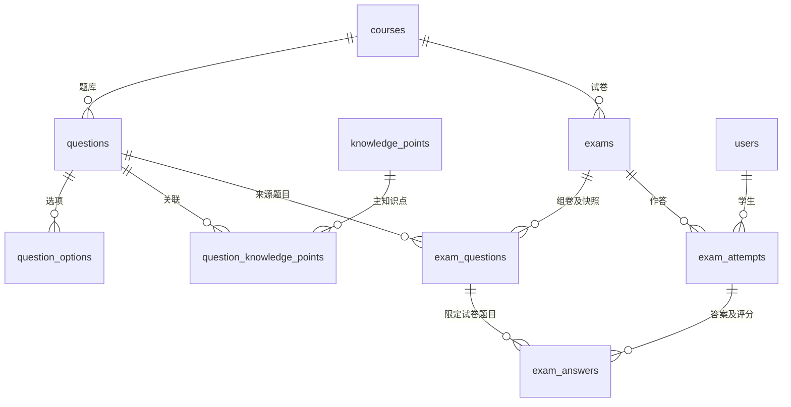

# 测验数据模型说明

定义位于 `app/models.py`，事务在 `app/services/exams.py`，评分统计在 `app/services/assessment.py`。测验七张表、账号课程七张表、资料四张表（含索引状态），另有诊断通知任务一张表，合计十九个启用模型。原用户、课程、知识点模型不改列。接口见 [测验业务接口说明](测验业务接口说明.md)，数据出口见 [内部数据接口与联调说明](内部数据接口与联调说明.md)，任务模型见 [诊断任务交付说明](诊断任务交付说明.md)。

## 1. 关系与存储约定



ID 字符串列使用 VARCHAR(64)，业务生成 UUID 的 32 位十六进制字符串。时间为 BIGINT Unix 秒。成绩使用 DECIMAL(8,2)，在 Python 中为 Decimal，接口转换为 JSON 数字。布尔值使用 SQLAlchemy Boolean（MySQL 通常为 BOOL/TINYINT）；数组和快照使用 JSON。

下述默认值除明确说明的数据库默认外，都由 ORM 或服务生成。通过原生 SQL 写入必须显式提供 ID、时间、JSON、分值等必需字段。JSON 默认使用可调用的 list，每行创建独立数组；服务采用整体赋值更新 JSON，不能依赖 ORM 检测列表的任意原地变更。

## 2. questions：题目表

| 字段 | 类型 | 可空 | 说明 |
| --- | --- | --- | --- |
| id | VARCHAR(64) | 否 | 主键，ORM 默认 UUID |
| course_id | VARCHAR(64) | 否 | 外键 courses.id，RESTRICT |
| kind | VARCHAR(20) | 否 | CHECK：single、multiple |
| stem | TEXT | 否 | 题干 |
| explanation | TEXT | 是 | 教师解析 |
| status | VARCHAR(20) | 否 | CHECK：draft、active、disabled；ORM/数据库默认 draft |
| created_at | BIGINT | 否 | ORM 插入默认当前时间 |
| updated_at | BIGINT | 否 | ORM 插入、实际更新默认当前时间，服务也显式维护 |

唯一键 `(course_id,id)` 支持同课程复合引用；索引 `(course_id,status)` 支持课程题库筛选。教师通过所属课程取得权限，不冗余保存 teacher_id。DELETE 接口仅将 status 改为 disabled，不物理删除。

## 3. question_options：题目选项表

| 字段 | 类型 | 可空 | 说明 |
| --- | --- | --- | --- |
| id | VARCHAR(64) | 否 | 主键，ORM 默认 UUID |
| question_id | VARCHAR(64) | 否 | 外键 questions.id，RESTRICT |
| label | VARCHAR(2) | 否 | 展示标识，接口限定 A～J |
| text | TEXT | 否 | 选项内容 |
| is_correct | BOOLEAN | 否 | 标准答案标记 |
| sort_order | INTEGER | 否 | 选项顺序，从 0 开始 |

唯一键 `(question_id,label)` 防止同题标签重复，也支持按 question_id 读取选项。选项数量、标签范围、单选一个正确项/多选至少两个正确项由请求与发布校验保证，单行 CHECK 无法直接验证整组数量。

完整修改题目会替换全部选项并生成新 ID。历史作答选择的是发布快照中的选项 ID，因此答案 JSON 不外键关联会被替换的当前选项表。

## 4. question_knowledge_points：题目知识点关联表

| 字段 | 类型 | 可空 | 说明 |
| --- | --- | --- | --- |
| question_id | VARCHAR(64) | 否 | 联合主键第一列 |
| knowledge_point_id | VARCHAR(64) | 否 | 联合主键第二列 |
| course_id | VARCHAR(64) | 否 | 同课程约束列 |

复合外键 `(course_id,question_id) → questions(course_id,id)`、`(course_id,knowledge_point_id) → knowledge_points(course_id,id)`，均 RESTRICT。对应两个索引分别为 `(course_id,question_id)`、`(course_id,knowledge_point_id)`。

数据库保证关联端点存在、课程一致且不重复；当前 API 限定恰好一个 active 主知识点。数据库结构允许未来多知识点关联，但当前不能绕过接口随意多绑，否则发布校验拒绝。

## 5. exams：试卷表

| 字段 | 类型 | 可空 | 说明 |
| --- | --- | --- | --- |
| id | VARCHAR(64) | 否 | 主键，ORM 默认 UUID |
| course_id | VARCHAR(64) | 否 | 外键 courses.id，RESTRICT |
| title | VARCHAR(100) | 否 | 名称，不要求全局唯一 |
| status | VARCHAR(20) | 否 | CHECK：draft、published、archived；ORM/数据库默认 draft |
| duration_seconds | INTEGER | 否 | CHECK：60～14400，ORM 默认 1800 |
| question_count | INTEGER | 否 | 配题/发布时计算，ORM 默认 0 |
| total_score | DECIMAL(8,2) | 否 | 配题/发布时求和，ORM 默认 0 |
| knowledge_snapshot | JSON | 否 | 发布时课程全部 active 知识点的 `{id,name}` 列表，ORM 默认空数组 |
| created_at | BIGINT | 否 | ORM 默认当前时间 |
| updated_at | BIGINT | 否 | ORM 插入/实际更新默认当前时间 |

唯一键 `(course_id,id)` 支持复合引用；索引 `(course_id,status)` 支持课程试卷查询。question_count、total_score 是受控汇总值，客户端不能直接指定。知识点目录快照使“未覆盖”知识点也可在结果中表现为样本不足，并防止未来改名影响历史。

## 6. exam_questions：试卷题目与发布快照

| 字段 | 类型 | 可空 | 说明 |
| --- | --- | --- | --- |
| exam_id | VARCHAR(64) | 否 | 联合主键第一列 |
| question_id | VARCHAR(64) | 否 | 联合主键第二列，同卷不能重复出现 |
| course_id | VARCHAR(64) | 否 | 同课程约束列 |
| sort_order | INTEGER | 否 | 试卷顺序，从 0 开始 |
| score | DECIMAL(8,2) | 否 | CHECK：>0 且 ≤1000 |
| snapshot | JSON | 是 | 草稿无快照，发布时冻结题目完整内容 |

复合外键 `(course_id,exam_id) → exams(course_id,id)`、`(course_id,question_id) → questions(course_id,id)`，均 RESTRICT，分别配置同列索引。保证不能把别的课程的题组进本课程试卷。

快照结构：

```json
{
  "id":"q1", "kind":"single", "stem":"题干", "explanation":"解析",
  "options":[{"id":"opt1","label":"A","text":"选项","is_correct":true}],
  "knowledge_points":[{"id":"kp1","name":"知识点","status":"active"}]
}
```

示例省略其他选项。发布后试卷及 exam_questions 由业务层冻结；数据库外键不自动防止直接 SQL 修改快照。学生公共 DTO 逐字段挑选，绝不直接返回整个 snapshot。

## 7. exam_attempts：学生测验作答记录

| 字段 | 类型 | 可空 | 说明 |
| --- | --- | --- | --- |
| id | VARCHAR(64) | 否 | 主键，ORM 默认 UUID |
| exam_id | VARCHAR(64) | 否 | 与 course_id 共同引用试卷 |
| course_id | VARCHAR(64) | 否 | 同课程约束列及历史筛选 |
| student_id | INTEGER | 否 | 外键 users.id，RESTRICT |
| baseline_attempt_id | VARCHAR(64) | 是 | 自外键 exam_attempts.id，RESTRICT；复测基准 |
| status | VARCHAR(20) | 否 | CHECK：in_progress、submitted、expired；ORM 默认 in_progress |
| started_at | BIGINT | 否 | 服务端首次开始时间 |
| expires_at | BIGINT | 否 | 开始时间 + 冻结时长 |
| submitted_at | BIGINT | 是 | 主动提交时间，或超时截止时间 |
| score | DECIMAL(8,2) | 是 | 评分后得分，进行中为 NULL |
| total_score | DECIMAL(8,2) | 否 | 开始时复制试卷总分 |
| knowledge_snapshot | JSON | 否 | 开始时复制发布的知识点目录，ORM 默认空数组 |
| knowledge_point_stats | JSON | 是 | 最终统计，进行中为 NULL |

约束与索引：

- `UNIQUE(exam_id,student_id)`：同一学生每份试卷一次，支持幂等开始。
- `UNIQUE(id,exam_id)`：供答案表同时验证作答和试卷归属。
- 复合外键 `(course_id,exam_id) → exams(course_id,id)`，RESTRICT。
- 索引 `(course_id,exam_id)`、`(status,expires_at)`、`(student_id,started_at)`，分别支持课程外键、超时扫描、学生历史。MySQL 同时为其他外键建立所需索引。

用户是否为学生、是否有效选课、基准是否本人同课程且已完成、日期先后等由服务在事务内检查。数据库外键只保证用户/基准存在，并不独立保证这些业务条件。保留历史，不随退课删除。

统计 JSON 每项为 `{knowledge_point_id,name,sample_count,correct_count,accuracy,status,evidence_question_ids}`。未覆盖项 accuracy=null；状态阈值和对比含义见接口文档。

## 8. exam_answers：答案与逐题成绩

| 字段 | 类型 | 可空 | 说明 |
| --- | --- | --- | --- |
| attempt_id | VARCHAR(64) | 否 | 联合主键第一列 |
| question_id | VARCHAR(64) | 否 | 联合主键第二列 |
| exam_id | VARCHAR(64) | 否 | 验证作答及试卷题目一致 |
| selected_option_ids | JSON | 否 | 选中的发布快照选项 ID，ORM 默认空数组 |
| revision | INTEGER | 否 | CHECK ≥0；ORM 默认 0，每次保存加一 |
| correct | BOOLEAN | 是 | 进行中 NULL；结算后 true/false |
| score | DECIMAL(8,2) | 是 | 进行中 NULL；结算后实际得分 |
| updated_at | BIGINT | 否 | ORM 默认当前时间；保存时服务显式更新 |

复合外键 `(attempt_id,exam_id) → exam_attempts(id,exam_id)`、`(exam_id,question_id) → exam_questions(exam_id,question_id)`，均 RESTRICT；分别配置同列索引。保证不能把另一个试卷的题目写进本次作答。

答案选项属于 JSON，数据库不验证其中选项是否合法；服务按发布快照验证题目归属、选项归属、重复值、单选数量。每次保存先锁作答行，整批检查 revision，再整体写入。重复提交锁同一记录、只评分一次。未答题提前建立空答案行，结算计零。

## 9. 建表、事务及验证

重启应用时 `Base.metadata.create_all(engine)` 创建缺失表，七张新增表按外键依赖自动排序创建。MySQL 数据库本身需事先存在，账号需要 DDL 权限，推荐 MySQL 8.0.16+ 以执行 CHECK 约束，并支持后台清理所需 SKIP LOCKED。

`create_all` 不修改已有同名表。若之前手动创建过不完整的题库/测验表，应先核验 `SHOW CREATE TABLE <表名>` 并单独迁移；不能通过反复重启补列，也不要删除有历史数据的表。此次代码未连接或修改现有业务库。

服务遵循请求级 Session（autoflush=False），父记录显式 flush 后再写关联表；写操作只在成功 commit 后返回。行锁与唯一键共同处理开始、保存及结算并发；数据库异常统一回滚，映射为 409 或 503。只读锁在请求会话关闭时释放。超时结算作为业务读取的一部分可产生写入，操作方需有相应权限。

模型 metadata、MySQL DDL 编译和替身回归可以验证代码声明；真实数据库约束与事务需通过独立 MySQL 集成测试核验，具体命令及建临时库行为见 [接口文档测试部分](测验业务接口说明.md#9-联调顺序与测试)。
