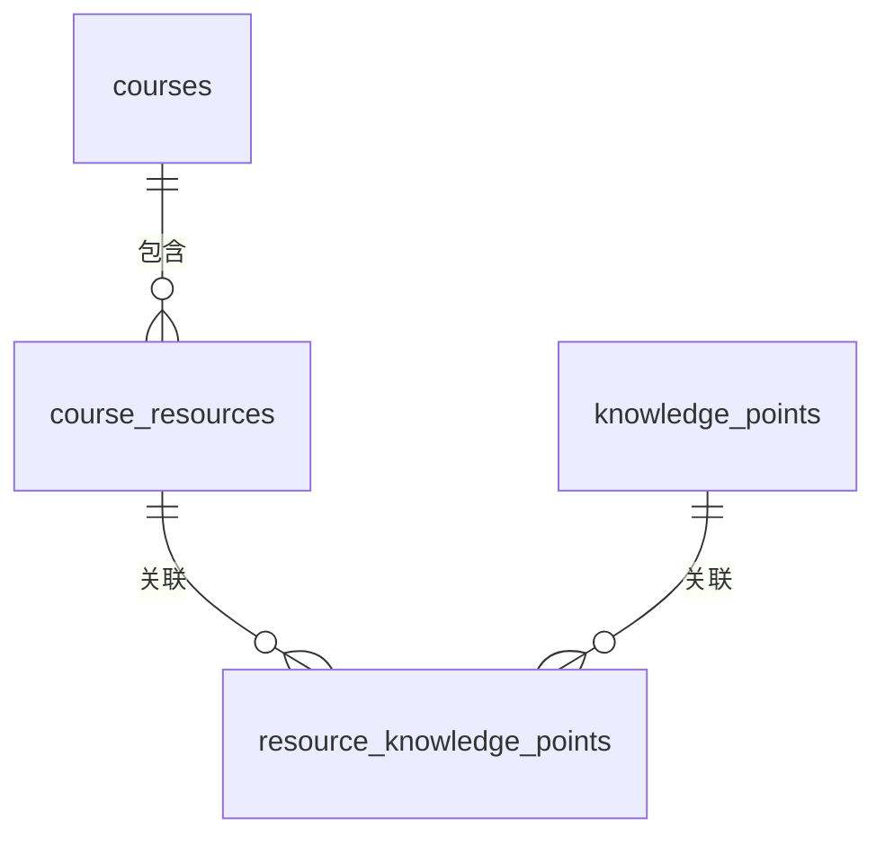

# 课程资料业务接口与模型说明

当前实现成员 B 的资料正文管理、知识点关联、版本控制和学生阅读，另支持 [PDF/DOCX 上传与原件下载](资料文件上传说明.md)。正文和元数据保存到 MySQL，上传原件保存在私有目录。B 保存资料不代表 C 已完成索引；index_status 表示 C 的当前处理状态。资料模块不主动调用 C/D，不创建资料同步任务；测验诊断通知属于独立的 [任务交付模块](诊断任务交付说明.md)。

本篇说明资料正文与知识点两张表、七个 CRUD/阅读接口；文件功能新增 resource_files 表和三个接口。内部对接新增第四张资料相关表 resource_index_states，以及 C 主动拉取/回报与 D 完整导出接口，详见 [内部数据接口与联调说明](内部数据接口与联调说明.md)。只有当前版本 ready 的有效资料才进入新内部诊断目录；旧教师导出为兼容原 D 模型仍保留空目录。

## 1. 接口总览

基础地址默认 `http://127.0.0.1:8000`，无 `/api/v1` 前缀。接口均需要 `Authorization: Bearer <access_token>`。下列正文接口使用 JSON；文件上传使用 multipart/form-data，下载返回二进制，见文件文档。

| 方法 | 路径 | 权限 | 成功状态 | 用途 |
| --- | --- | --- | --- | --- |
| POST | `/teacher/courses/{course_id}/resources` | 所属教师 | 201 | 创建纯文本资料 |
| GET | `/teacher/courses/{course_id}/resources` | 所属教师 | 200 | 分页查询课程资料 |
| GET | `/teacher/resources/{resource_id}` | 所属教师 | 200 | 资料详情，包含已删除资料 |
| PATCH | `/teacher/resources/{resource_id}` | 所属教师 | 200 | 按预期版本修改资料 |
| DELETE | `/teacher/resources/{resource_id}` | 所属教师 | 200 | 逻辑删除，保留正文与关联 |
| GET | `/courses/{course_id}/resources` | 有效选课学生 | 200 | 分页查询有效资料 |
| GET | `/resources/{resource_id}` | 有效选课学生 | 200 | 阅读有效资料正文 |

教师使用教师路径查看自己课程；学生路径仅接受 student 角色。未选课、已退课、其他教师和其他学生不能通过资料 ID 绕过授权。

## 2. 模型与约束

### 2.1 CourseResource / course_resources

| 字段 | MySQL 类型 | 可空 | 默认与说明 |
| --- | --- | --- | --- |
| id | VARCHAR(64) | 否 | 主键；ORM 默认 UUID 32 位十六进制字符串 |
| course_id | VARCHAR(64) | 否 | 外键 courses.id，ON DELETE RESTRICT |
| title | VARCHAR(200) | 否 | 标题，允许同课程重名 |
| text | MEDIUMTEXT | 否 | 纯文本正文，接口限制 1～200000 字符 |
| source | VARCHAR(1000) | 否 | ORM/数据库默认“课程教师自编材料” |
| version | INTEGER | 否 | ORM/数据库默认 1，CHECK ≥1 |
| status | VARCHAR(20) | 否 | ORM/数据库默认 active，CHECK active/deleted |
| created_at | BIGINT | 否 | ORM 插入默认当前 Unix 秒 |
| updated_at | BIGINT | 否 | ORM 插入/实际更新默认当前 Unix 秒，服务显式维护 |

共九个字段。不重复保存 teacher_id，教师归属通过 courses.teacher_id 判断；不保存独立 chapter_id，资料可以跨章节关联多个知识点。

`UNIQUE(course_id,id)` 为资料关联表提供复合引用；索引 `ix_course_resources_course_status_updated(course_id,status,updated_at)` 支持课程、状态及更新排序。表使用 InnoDB，字符集和排序规则继承目标数据库，须与现有父表外键列一致。MEDIUMTEXT 用于避免普通 TEXT 约 64KB 的容量限制影响中文长正文。

默认 ID 和时间由 ORM/服务生成，原生 SQL 插入需显式提供 ID、正文、标题、课程和时间。直接 SQL 更新也需维护 version、updated_at，不能绕开业务服务随意修改。

### 2.2 ResourceKnowledgePoint / resource_knowledge_points

| 字段 | MySQL 类型 | 约束 |
| --- | --- | --- |
| resource_id | VARCHAR(64) | 联合主键第一列 |
| knowledge_point_id | VARCHAR(64) | 联合主键第二列 |
| course_id | VARCHAR(64) | NOT NULL，同课程约束 |

- `fk_resource_points_resource`：`(course_id,resource_id) → course_resources(course_id,id)`。
- `fk_resource_points_point`：`(course_id,knowledge_point_id) → knowledge_points(course_id,id)`。
- 两个外键均为 RESTRICT；对应索引 `(course_id,resource_id)`、`(course_id,knowledge_point_id)`。
- 数据库保证关联端点存在、课程一致和不重复；接口进一步要求提交的知识点均 active，数量 1～50。
- 逻辑删除不会删除这些关系。已有标签以后被停用，不会自动删除资料；仅更新正文/标题时不强制重新选标签，但重新提交标签数组时会重新校验有效性。



## 3. 创建资料

```http
POST /teacher/courses/{course_id}/resources
```

使用课程详情中真实的知识点 ID，例如课程演示 SQL 导入后的数据结构课程：

```json
{
  "title": "栈的基本概念与操作",
  "text": "栈遵循后进先出原则。入栈、出栈和读取栈顶都围绕栈顶进行。",
  "source": "课程教师自编材料",
  "knowledge_point_ids": [
    "demo-kp-stack-concept",
    "demo-kp-stack-operations"
  ]
}
```

路径 course_id 为 `demo-course-ds-teacher-2`，教师需登录对应课程的真实创建者账号。示例仅在已导入相应演示课程时适用。

| 字段 | 必填 | 规则 |
| --- | --- | --- |
| title | 是 | 去首尾空白，1～200 字符 |
| text | 是 | 去首尾空白，1～200000 字符；内部换行保留 |
| source | 否 | 默认“课程教师自编材料”；传入时去首尾空白，1～1000 字符，不能为 null |
| knowledge_point_ids | 是 | 1～50 个不重复 ID，每个长度 1～64；属于本课程且 active |

客户端不能提交 id、course_id、teacher_id、status、version、document_id、sync_status 等服务器或后续接入字段；未知字段返回 422。资料不要求全局或同课程标题唯一。

成功响应示例：

```json
{
  "code": 0,
  "message": "ok",
  "data": {
    "id": "接口实际返回的资料ID",
    "course_id": "demo-course-ds-teacher-2",
    "title": "栈的基本概念与操作",
    "text": "栈遵循后进先出原则。入栈、出栈和读取栈顶都围绕栈顶进行。",
    "source": "课程教师自编材料",
    "version": 1,
    "status": "active",
    "knowledge_point_ids": ["demo-kp-stack-concept", "demo-kp-stack-operations"],
    "created_at": 1800000000,
    "updated_at": 1800000000
  },
  "request_id": "本次请求追踪ID"
}
```

所有后续接口中的 resource_id 都使用创建响应 data.id。新建接口没有请求幂等键；网络超时后应先查看列表确认结果，再决定是否重复创建。

创建 JSON 资料时 data.original_file 为 null；文件上传创建的资料该字段为原文件元数据。资料列表、详情和修改响应也包含此字段，不暴露本机存储路径。

创建、上传、详情、修改和列表响应另含 index_status：新建为 pending，C 确认后为 ready，失败为 failed；删除索引确认后为 deleted（所属教师可查看）。实际更新/删除与 pending 标记同事务提交；无实际变化的修改和重复删除不重置已有回报。索引状态不影响资料正文阅读和原件下载，不能由普通创建/修改请求指定。

## 4. 列表与详情

### 4.1 教师列表

GET `/teacher/courses/{course_id}/resources`，支持：

| 参数 | 默认 | 说明 |
| --- | --- | --- |
| page | 1 | 整数，≥1 |
| page_size | 20 | 整数，1～100 |
| status | active | active / deleted；删除记录需显式查询 deleted |
| knowledge_point_id | 不筛选 | 按知识点关联过滤，长度 1～64 |
| keyword | 不筛选 | 标题子串，最多 100 字符；百分号等按字面处理 |

按 updated_at 降序、id 升序分页。响应 data 为 `{items,total,page,page_size}`。items 字段与创建详情一致，但**不包含 text**；SQL 列表查询也不会读取大正文。知识点 ID 数组按 ID 排序，不保留提交顺序。

### 4.2 教师详情

GET `/teacher/resources/{resource_id}`，返回完整正文和元数据。所属教师能查询 active/deleted 资料，也能查询已归档课程资料。已删除资料不支持恢复或修改。

### 4.3 学生列表和正文

GET `/courses/{course_id}/resources` 支持 page、page_size、knowledge_point_id、keyword，字段与教师列表一致，但固定只查 active。

GET `/resources/{resource_id}` 返回完整正文和元数据。

学生须有本课程 active 选课，且课程为 published 或 archived。课程草稿、未选课、退课、资料已删除均返回 404。课程归档后，有效选课学生仍可阅读，保持现有课程内容可见性规则。

资料知识点关系按实际存储返回；知识点停用不会自动隐藏资料。学生的正文阅读不依赖 C/D 是否运行；响应中的 index_status 只描述索引处理状态，不阻止正文阅读。

## 5. 修改与版本控制

```http
PATCH /teacher/resources/{resource_id}
```

```json
{
  "expected_version": 1,
  "title": "栈的基本概念与应用",
  "text": "更新后的纯文本正文。",
  "knowledge_point_ids": ["demo-kp-stack-concept"]
}
```

- expected_version 必填，为当前详情的 version，严格整数，1～2147483647。
- title、text、source、knowledge_point_ids 至少提交一个；省略表示保持原值，传 null 不允许。
- 重新提交 knowledge_point_ids 会整体替换关联，不做追加；须重新通过同课程、active 和去重校验。
- 服务先锁课程和资料，检查 expected_version；不一致返回 409，不覆盖其他页面的修改。
- 实际内容/标签有变化时 version 加一，updated_at 更新；没有实际变化（含标签只换顺序）不加版本、不更新时间。
- 正文和标签的变更在同一个事务提交；任一知识点不合规时整次修改不写入。
- 返回修改后的完整详情。保存后使用响应中的新 version；响应丢失时先刷新详情，不能假定仍是旧版本。

本模块不保留每次正文修订的独立历史版本行；version 用于并发冲突检查，不代表可以查询任意旧版本。后续接 C 时可以在此基础上增加文档版本和同步快照。

已上传资料的原 PDF/DOCX 不随 PATCH 正文变化；original_file.resource_version 标识原件对应的初次上传版本。

## 6. 删除与课程归档

DELETE `/teacher/resources/{resource_id}` 无请求体。

第一次删除将 status 更新为 deleted、version 加一、维护 updated_at，保留原正文和全部知识点关联。成功响应 data：

```json
{
  "id": "接口实际返回的资料ID",
  "course_id": "demo-course-ds-teacher-2",
  "status": "deleted",
  "version": 3,
  "updated_at": 1800000300
}
```

示例假设该资料已经修改过一次。重复删除返回原删除状态，版本和时间不再变化，不物理删除、不创建重复记录。

归档课程不能新增、修改或首次删除资料。对已经删除的资料再次 DELETE 仍返回原状态，因为没有进行新的修改。教师始终需要满足所属课程权限。

## 7. 错误约定

| HTTP | 原因 |
| --- | --- |
| 401 | 未登录、Token 无效或过期 |
| 403 | 角色不允许，例如学生使用教师接口 |
| 404 | 对象不存在、教师非课程所有者、学生无有效选课/课程不可见/资料已删除 |
| 409 | 资料版本冲突、课程归档、资料已删除、知识点不可用或跨课程、数据库关联冲突 |
| 422 | 请求字段或类型不符、额外字段、空正文、重复标签、缺少 expected_version 等 |
| 503 | 数据库连接、执行或提交异常；不会返回未提交的成功结果 |

错误和成功包装复用 [总接口约定](接口详细说明.md)。此模块不发送邮件、不调用知识库或诊断服务。

## 8. 建表与联调

安装最新 requirements.txt 并重启新版后端后，自动创建缺失的 course_resources、resource_knowledge_points、resource_files，不改变既有用户、课程、知识点、试卷或作答表。也可以手动执行 [建表 SQL](../sql/create_course_resource_tables.sql)：

```sh
mysql --default-character-set=utf8mb4 -h 127.0.0.1 -P 3306 -u root -p < sql/create_course_resource_tables.sql
```

执行前按实际情况修改 USE 数据库名；父表及 `knowledge_points(course_id,id)` 唯一键需已存在。create_all 和 CREATE TABLE IF NOT EXISTS 只建缺失表，不会给已有同名旧表补字段或约束。用文件末尾的 SHOW CREATE TABLE 核验实际结构。

推荐 Swagger 联调顺序：

1. 教师登录并 Authorize，查询自己的课程详情，取得真实 course_id 和知识点 ID。
2. POST 创建资料，保存响应 data.id 和 version。
3. GET 教师列表，验证列表无正文；GET 教师详情获取正文。
4. PATCH 时带 expected_version，验证变更后版本增加；用旧版本修改应返回 409。
5. 学生登录，选课后 GET 学生列表及正文；未选课学生应返回 404。
6. 教师删除资料后，学生读不到；教师可通过 status=deleted 或详情查到原记录。

## 9. 测试与当前范围

```sh
python -m pytest -q tests/test_resources.py tests/test_resource_files.py tests/test_startup.py tests/test_mysql_resources.py
```

test_resources.py 使用数据库替身和 MySQL 方言，覆盖字段、角色、所有权、选课、归档、标签、分页、版本、逻辑删除和故障回滚。

test_mysql_resources.py 仅在显式配置 TEST_MYSQL_URL 后运行。它新建 `ld_resource_test_<随机值>` 数据库、执行真实登录及资料 CRUD、验证超过普通 TEXT 容量的中文正文和复合外键，最后删除该临时库。账号需具备测试库 CREATE/DROP DATABASE 权限，不读取 DATABASE_URL 作为业务目标。未配置连接时跳过，不应将替身回归描述为已验证真实 MySQL。

当前已支持文本型 PDF、DOCX 正文提取和鉴权下载，限制见 [资料文件上传说明](资料文件上传说明.md)。尚不包含 OCR、旧 DOC、资料历史正文查询、C 的索引同步/重试/检索、D 的诊断调用或报告保存。后续接入方案见 [BCD 数据契约设计稿](BCD数据契约V1.md)，其中建议字段与路由尚待三方确认。
